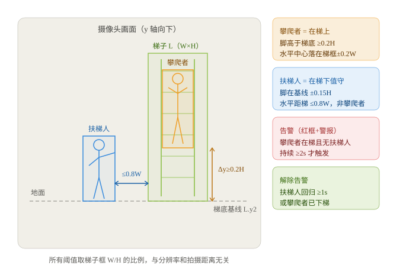

# 登高守护（Ladder Guard）实现方案

> 需求：检测到**有人在梯子上**时，必须有**扶梯人**在梯子下方值守，否则触发告警（红框 + 警报）。
> 本文 = 实现思路 + 判定几何示意图 + 代码说明 + 调参指引。代码：本目录 `detect_ladderguard.py`。

## 1. 资产盘点（不新增模型、不改训练）

| 资产 | 类别 | 在本功能中的角色 |
|------|------|------|
| `runs/detect/ladder_yolo11n/weights/best.pt` | 1 类：Ladder | **触发源**——画面里有梯子才激活守护逻辑 |
| `runs/detect/ppe2_yolo11n/weights/best.pt` | 5 类：un_helmet/helmet/**people**/vest/workWear | **人员框（默认）**——本项目 PPE 自有域权重，只用 `people` 类；全 8 张测试图判定与 COCO 完全一致 |
| `scripts/yolo11n.pt` | COCO，含 person | 域外兜底备选，效果与 PPE 权重相当 |
| `runs/detect/ppe2_yolo11n-2/weights/best.pt` | 同上 5 类 | ❌ 实测**漏掉梯上攀爬者** → 功能静默失效，不要用 |
| `runs/detect/laddersafe_yolo11n/weights/best.pt` | 4 类：ladder_with/without_outriggers、worker_with/without_helmet | ❌ 1080p 全场景**漏掉弯腰扶梯的人** → 会把合规画面误判成违规 |

双模型同一帧各跑一次推理；laddersafe 的 `ladder_without_outriggers`（未装支撑腿）可后续与本告警并联上报。
脚本自动从模型类别表里识别梯子类 / 人员类（子串匹配 `ladder` / `worker` / `person` / `people`），
换权重无需改代码；`workWear` 不含 `worker`，故 PPE 权重只有 `people` 会入选人员类，
安全帽 / 反光背心等框不会混进人框列表。

> **人检测模型是本功能的真实瓶颈**，不是几何规则。几个候选权重都只见过 640×640 裁剪图，
> 搬到整幅工地画面存在域偏移：两个 PPE 权重里 `ppe2_yolo11n` 检得最全（梯上 conf 0.75、
> 梯下弯腰扶梯人 conf 0.63），`ppe2_yolo11n-2` 却整只漏掉梯上的人，laddersafe 漏弯腰扶梯人。
> 因此默认锁定 `ppe2_yolo11n`；生产上线前仍建议用现场画面微调 person 模型
> （全图、正负样本覆盖弯腰/攀爬姿态），这是提升准确率性价比最高的一步。

## 2. 判定几何（核心）



所有阈值取**梯子框自身宽高 W/H 的比例**，不写死像素——换分辨率、换机位、梯子远近都不用重新调参。
坐标系为图像坐标，**y 轴向下**，"脚高于梯底"即人框底边 y 坐标更小。

| 角色 | 判定条件 | 阈值（默认） |
|------|------|------|
| 攀爬者（在梯上） | 人框水平中心落在梯框 ±`CLIMBER_DX`·W 内，**且** 人框底部（脚）高于梯底 ≥ `CLIMBER_DY`·H | 0.2W / 0.2H |
| 扶梯人（梯下值守） | 非攀爬者，水平距梯框 ≤ `SPOTTER_DX`·W，**且** 脚部位于梯底基线 ±`SPOTTER_DY`·H | 0.8W / 0.15H |

要点：

- **先判攀爬者、剩下的人再判扶梯人**——攀爬者绝不能同时算扶梯人。
- 攀爬判定只看"脚离地"，不要求人框与梯框 IoU（攀爬者与梯子高度重叠是常态，IoU 必然不稳）。
- 攀爬者站在梯顶作业时脚部远高于梯底，依然命中攀爬规则——正确行为，作业全程都需要扶梯人。

## 3. 逐帧流水线

```
每帧:
  1. 双模型推理 → 梯子框集合 L[], 人框集合 W[]
  2. 无梯子 → 守护不激活，直接下一帧
  3. 有梯子 → 按梯子分组，对每把梯子 L:
       攀爬者 = 满足 §2 攀爬条件的人
       扶梯人 = 满足 §2 值守条件的人
  4. 状态机推进（§4），ALARM 时画红框 + NO SPOTTER + 抓拍
```

## 4. 防抖状态机（告警不闪烁的核心）

逐帧判定抖动大（NMS 抖、遮挡漏检一帧），直接逐帧报警会疯掉。**每把梯子一个状态机实例**，
跨帧用 IoU ≥ 0.3 跟踪梯子身份，多人多梯互不干扰。

| 状态 | 含义 | 迁移 |
|------|------|------|
| IDLE | 无攀爬者 | 检测到攀爬者 → CLIMBING |
| CLIMBING | 有攀爬者 | 无扶梯人持续 ≥ `GRACE_SEC`(2s) → ALARM；攀爬者下梯 → IDLE |
| ALARM | 告警中 | 扶梯人**连续在场** ≥ `CLEAR_SEC`(1s) → CLIMBING；攀爬者下梯 → IDLE |
| （销毁） | — | 梯子连续丢失 ≥ `LOST_SEC`(1s) → 状态机删除 |

- `GRACE_SEC` 宽限：给"工人刚上梯、扶梯人正走过来"的正常时序留缓冲，避免瞬时报警。
- `CLEAR_SEC` 要求扶梯人**连续**在场：防遮挡漏检一帧就误消警。
- 每次进入 ALARM 自动抓拍一帧存 `<out>/alarm/`，供事后存证/人工复核。

## 5. 已知坑与对策

| 坑 | 对策 |
|----|------|
| **人检测域偏移**（本功能最大风险） | 两个 PPE 权重表现不同：`ppe2_yolo11n` 检得全（默认），`-2` 漏梯上攀爬者；laddersafe 漏弯腰扶梯人、COCO 可作兜底 → 生产上仍建议用现场画面微调 person 模型 |
| **imgsz 太小漏人** | 1080p 场景实测：`imgsz 640` 梯上的人漏检（告警静默失效），`1280` 正常。默认已设 1280 |
| **梯子重复框** | 同一把梯子常同时给出「整梯框 + 只框住上半段的子框」，子框底边不是真梯底 → 判定前聚合为并集框（`merge_ladders`），否则凭空多告警 |
| 扶梯人被梯子/攀爬者遮挡漏检 | 单目视觉物理上限；靠 CLEAR_SEC 消警门槛 + ALARM 抓拍人工复核兜底 |
| 多人多梯 | 按梯子分组独立判定，每梯一个状态机 |
| 双模型耗时 | 1280 输入下 4060 单帧约 100ms；上 RK356x 边缘端建议降到 640 并接受漏检，或换小模型 |
| 图片模式没有时间轴 | 状态机不生效，退化为单帧几何判定（有攀爬者无扶梯人 → 直接画红框） |
| 域外误检 | ladder 模型只见过 640×640 梯子裁剪图：人像照片被误判成梯子（conf 0.61），街景可能乱报；本域（工地画面）验证真实效果 |

## 6. 违规判定输出（终判）

**违规定义：有人在梯子上，且梯下无人看护。** 其余三种情形一律不违规。

| 情形 | 判定 | 判定原因文案 | 画面横幅 |
|------|------|------|------|
| 无梯子 | 不违规 | 无梯子，不涉及登高守护 | `N/A NO LADDER` |
| 有人登高 + 无人看护 | **违规** | 有人登高、无人看护 | `VIOLATION NO SPOTTER`（红） |
| 有人登高 + 有人看护 | 不违规 | 有人登高、有人看护 | `OK SPOTTED`（绿） |
| 有梯子但无人登高 | 不违规 | 有梯子但无登高作业 | `OK NO CLIMB`（绿） |

输出位置：

- **图片模式**：每张打印一行 `违规判定: 违规/不违规 —— 原因` + 检出统计，全部跑完打印
  `最终结果: 违规/不违规 —— ...（违规 N 张）`。
- **视频/摄像头**：逐帧在画面左上角画红/绿判定横幅；结束时打印
  `最终结果: ...（违规帧 N/总帧）`。视频模式下「违规帧」= 状态机已进入 ALARM 的帧，
  短时漏检落在 2s 宽限内不算违规。
- cv2.putText 不支持中文，画面横幅用英文；中文判定打到控制台。

## 7. 实测结果（scripts/media，imgsz 1280，conf 0.25）

| 图片 | 内容 | 检出 | 终判 |
|------|------|------|------|
| `ladder3.png` | 地铁站内工人独自在梯上作业，梯下无人 | ladder:1 climber:1 | **违规**（有人登高、无人看护） |
| `ladder_yes.jpg` / `ladder1.png` / `ladder2.png` | 梯上作业 + 梯下有人扶着 | ladder + climber + spotter | 不违规（有人看护） |
| `bus.png` / `img.png` / `liangren.png` | 街景、室内、双人 | 无梯子 | 不违规（不涉及） |
| `no_test.jpg` | 人像照片（无梯子） | ladder:1 spotter:2 | 不违规（有梯子但无登高作业；梯子是域外误检） |

8 张全量实测（默认参数，人模型 = PPE `ppe2_yolo11n`）：
`最终结果: 违规 —— 存在登高无人看护画面（违规 1 张）`，命中 `ladder3.png`。
`ladder_yes.jpg` 结果图里 `ON LADDER 0.75` 正确框住梯上作业者、蓝色 `SPOTTER 0.63` 框住梯下弯腰扶梯者、
左上角绿色 `OK SPOTTED`；`ladder3.png` 则是红色 `VIOLATION NO SPOTTER` + `NO SPOTTER 0.84`。

**人模型权重横向对比**（同一批 8 张、imgsz 1280、conf 0.25，只看关键图）：

| 人模型 | `ladder_yes.jpg`（应合规） | `ladder3.png`（应违规） | `bus.png`（应不涉及） | 结论 |
|------|------|------|------|------|
| **PPE `ppe2_yolo11n`** | climber:1 spotter:2 → 不违规 | climber:1 → 违规 | 无梯子 | ✅ **默认** |
| COCO `yolo11n.pt` | climber + spotter → 不违规 | climber → 违规 | 无梯子 | ✅ 效果相当，域外兜底 |
| PPE `ppe2_yolo11n-2` | 漏梯上的人，只剩 spotter | 无 climber → **漏报** | 无梯子 | ❌ 静默失效 |
| `laddersafe_yolo11n` | 漏弯腰扶梯人 → **误报** | climber → 违规 | 无梯子 | ❌ 误报 |

另测 conf 降到 0.10：`bus.png` 等域外图会出现梯子误检并连带误报，故 conf 保持 0.25。

违规分支用合成框走完整打印路径验证：
`有人登高 + 无人看护 -> 违规判定: 违规 —— 有人登高、无人看护；最终结果: 违规（违规 1 张）`，
`有人登高 + 有人看护 -> 不违规（有人登高、有人看护）`。

外域图片可接受的误检是「多画框」，不可接受的是「误报/漏报」。当前 `no_test.jpg` 属前者。
真正需要现场验证的是：**扶梯人离开 → 2s 后告警 → 扶梯人回归 → 1s 后消警** 这条时序，
建议补一段连续视频做回归（media/videos 里没有爬梯素材）。

状态机逻辑已用合成框离线验证通过：
`仅梯子 IDLE → 上梯 CLIMBING → 无扶梯人 2.2s ALARM → 扶梯人连续在场 1.1s 回 CLIMBING → 再脱离 2.5s 再 ALARM → 下梯 IDLE → 梯子丢失 1.2s 状态机销毁`。

## 8. 用法（仓库根目录 D:/code/ultralytics 下执行）

> 注意本机 PATH 陷阱：直接敲 `python` 会解析到 WorkBuddy 自带的 3.13（没装 numpy/ultralytics）。
> 用环境显式路径：`C:/Users/dltt6/.conda/envs/ultralytics/python.exe`

```bash
# 单张图片（默认 imgsz=1280 + PPE ppe2_yolo11n 的 people 类）
python scripts/ladderguard/detect_ladderguard.py --source scripts/media/ladder_yes.jpg --no-show

# scripts/media 整个文件夹
python scripts/ladderguard/detect_ladderguard.py --source scripts/media --no-show

# 摄像头（实时窗口，q 退出）
python scripts/ladderguard/detect_ladderguard.py --source 0

# 视频 + 抬高置信度 + 收紧宽限
python scripts/ladderguard/detect_ladderguard.py --source video.mp4 --conf 0.4 --grace 1.0

# 换人员权重（COCO 兜底；不要用 ppe2_yolo11n-2 / laddersafe，理由见 §1）
python scripts/ladderguard/detect_ladderguard.py --source 0 \
    --person-model scripts/yolo11n.pt --imgsz 640
```

结果落在 `runs/detect/ladderguard_result/`（图片 `_pred` 后缀、视频 `output.mp4`、告警抓拍 `alarm/`）。

画面颜色约定：绿=梯子，橙=攀爬者（有人扶），蓝=扶梯人，红=NO SPOTTER 告警，灰=未参与判定的路人。

## 9. 调参指引

| 参数 | 默认 | 调整时机 |
|------|------|------|
| `--imgsz` | 1280 | 1080p 场景保持 1280（640 实测漏掉梯上的人）；裁剪图/小图域用 640 |
| `--grace` | 2.0s | 现场扶梯人到位慢就调大；要求更严苛就调小 |
| `--clear` | 1.0s | 扶梯人频繁被遮挡误消警就调大 |
| `CLIMBER_DY`（代码常量） | 0.2H | 想要"脚一离地就算攀爬"就调小 |
| `SPOTTER_DY`（代码常量） | 0.15H | **仰角大的机位**（脚和梯底在像素上错位大）要放宽，如 0.25H |
| `SPOTTER_DX`（代码常量） | 0.8W | 扶梯人站位习惯离梯远就放宽 |
| `IOU_MATCH`（代码常量） | 0.3 | 梯子被部分遮挡导致框跳动、频繁新建状态机时调小 |

## 10. 后续扩展点

- 告警外发：`run_stream` 里进入 ALARM 处挂回调（声光警报器 / 平台推送），`detect_ladder.py` 同款思路。
- 与 laddersafe 的 `ladder_without_outriggers` 并联：未装支撑腿 + 无人扶梯可合并为"登高作业风险"复合告警。
- 现场画面微调 person 模型：这是提升准确率性价比最高的一步（当前漏检全部来自人检测域偏移）。
- 补连续视频做状态机回归（media/videos 里没有爬梯素材）。
